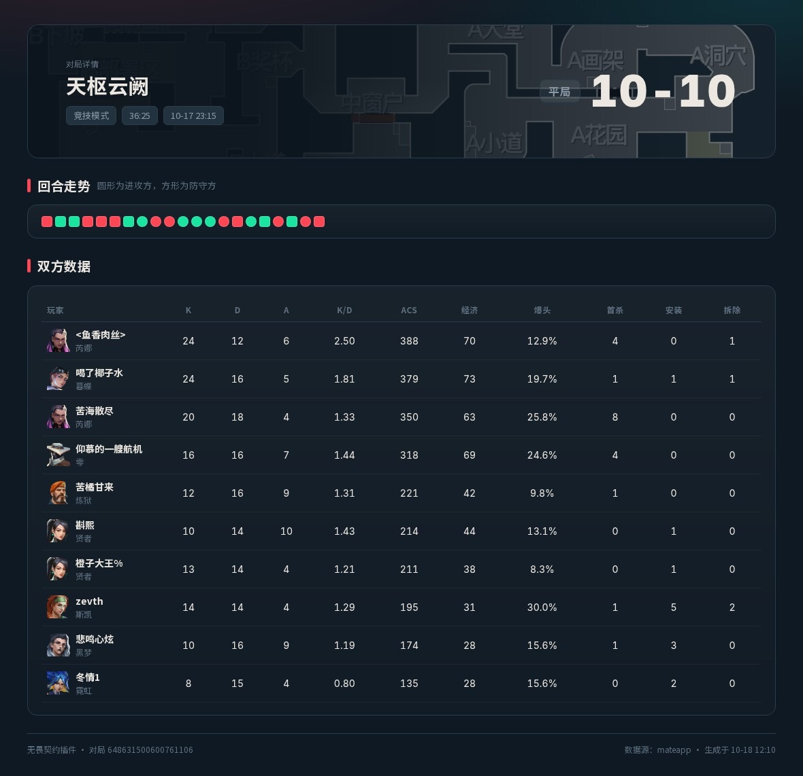
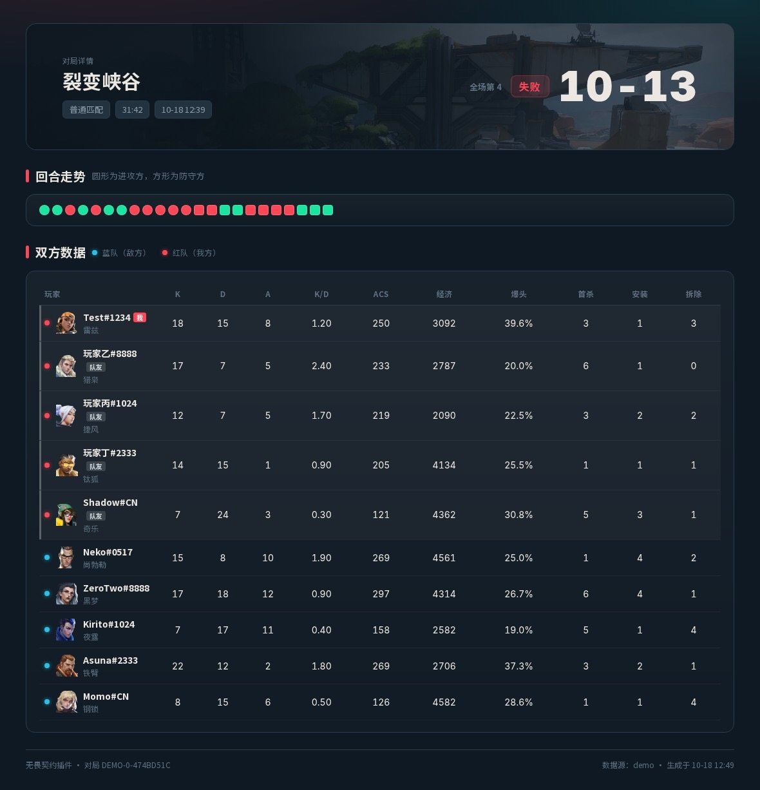
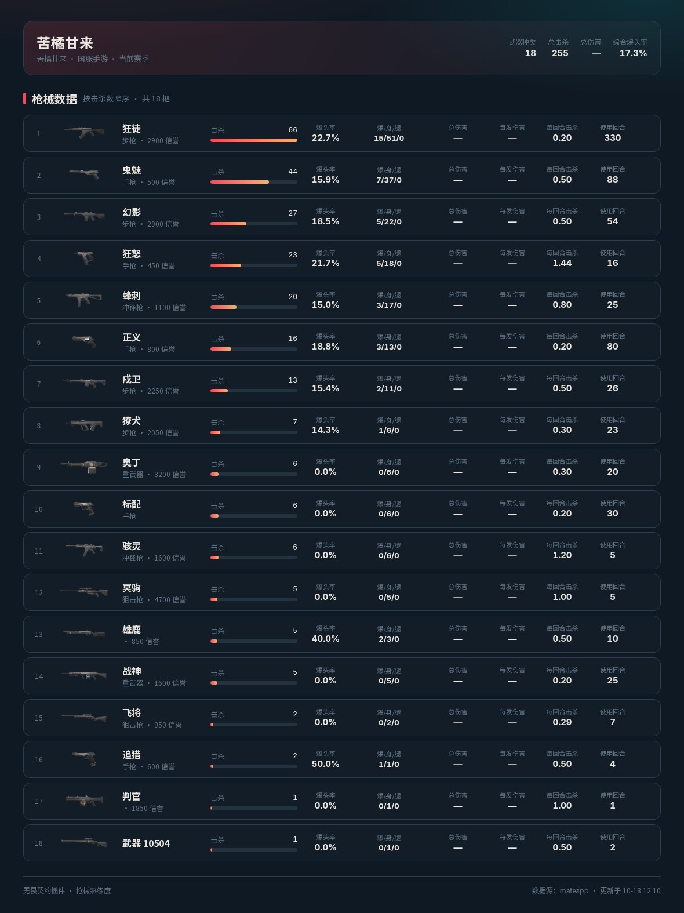
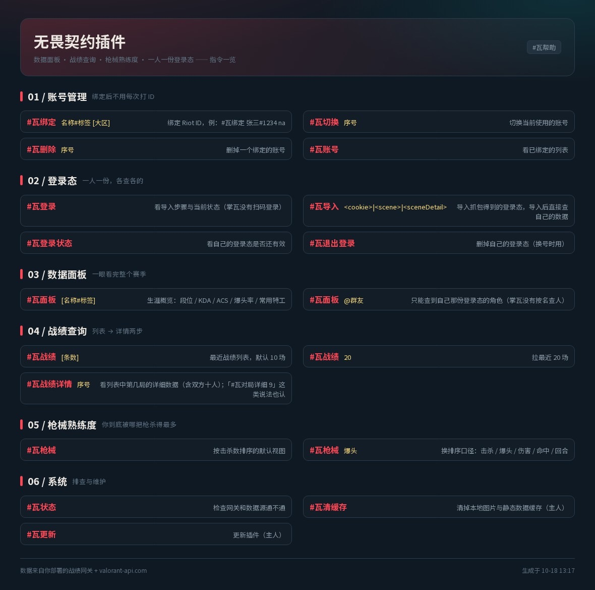
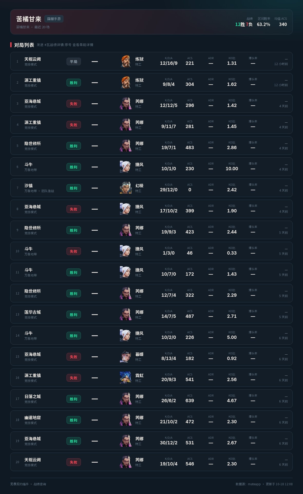
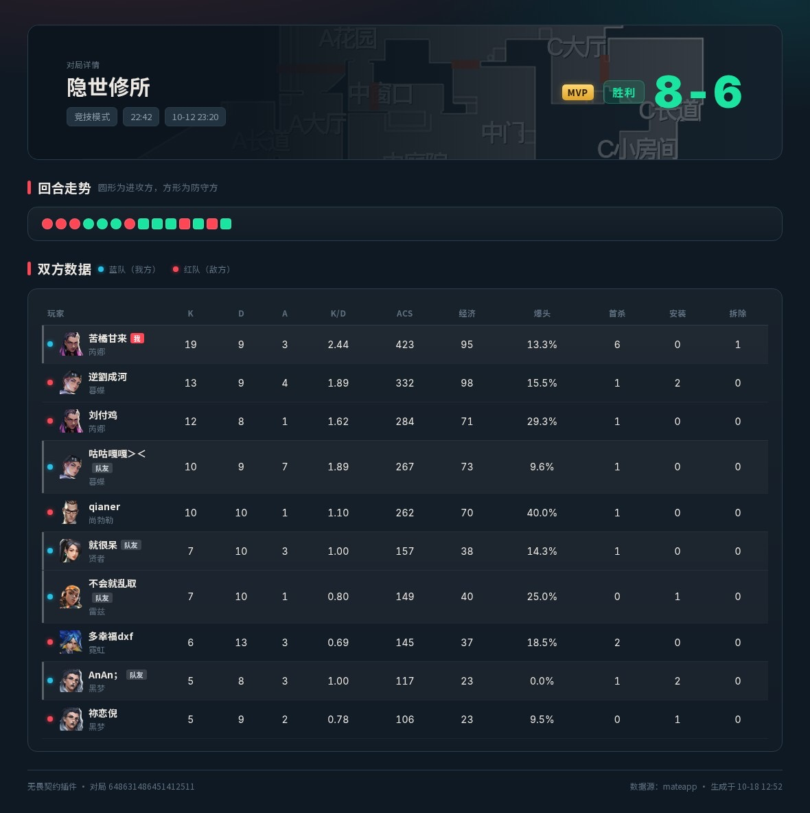
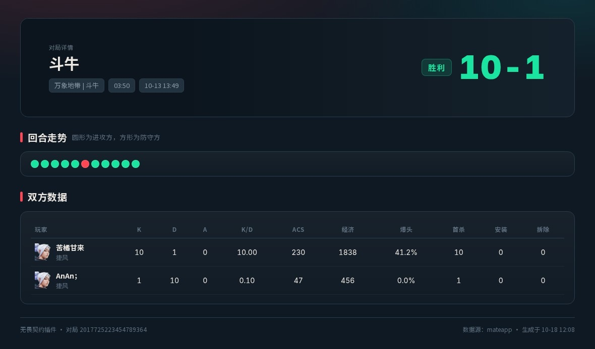
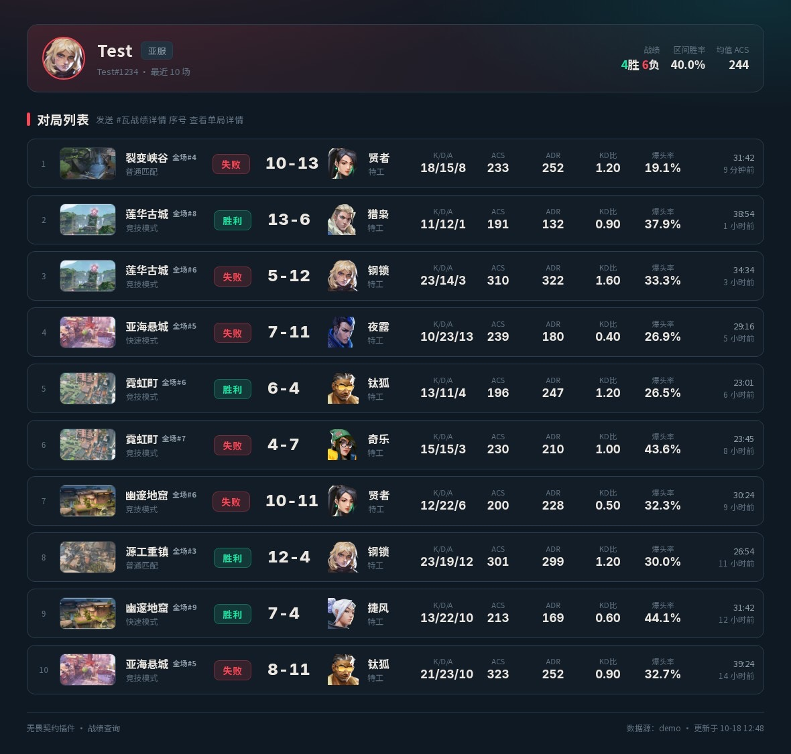

# 无畏契约插件（Valorant-Plugin）

面向 **TRSS-Yunzai / Yunzai V3** 的无畏契约（VALORANT，含手游国服「掌上无畏契约」）查询插件：
**数据面板 · 战绩列表 · 单局详情（红蓝敌我 + MVP）· 枪械熟练度 · 一人一份登录态**。
出图走云崽自己的渲染器（art-template + Chromium），交互与 [和平精英插件](https://gitee.com/Tloml-Starry/PUBG-Helper-Plugin)、[王者荣耀插件](https://github.com/cchanlan/GloryOfKings-Plugin) 同一套骨架。

[](https://github.com/TimeRainStarSky/Yunzai)
[](LICENSE)
[](https://nodejs.org)

```
#瓦帮助          指令一览（出图）
#瓦面板          生涯数据面板
#瓦战绩          最近 10 场
#瓦战绩详情 3     第 3 场单局详情
#瓦枪械          枪械熟练度
#瓦登录          导入自己的登录态（一人一次，之后各查各的）
```

---

## ⚠️ 请先读这一段：**目前数据只能靠抓包获取**

**这个插件没有、也做不出「填个昵称就能查」的道路。** 无畏契约国服（掌瓦）不像王者营地那样有对外免登录接口，所有玩家数据都得带着 App 自己的登录态才能取。

所以现在的流程是：

1. 你在手机上用抓包工具把掌瓦的**一次请求**复制成 cURL；
2. 发给机器人执行 `#瓦导入`；
3. 之后查战绩用的就是这份登录态。

由此带来三个必须接受的现实（不是没做完，是上游就没给别的口子）：

| 现实 | 说明 |
| --- | --- |
| **每人得自己抓一次包** | 抓包对普通群友有门槛。插件已把流程压到「长按 → 复制为 cURL → 粘贴」，但绕不过这一步 |
| **不能扫码登录** | 掌瓦的 `scene` 由 QQ/微信 SDK 在 App 内签名下发，服务端复现不了。三种尝试全部失败，详见 [第四节](#四登录态一人一份各查各的) |
| **登录态会过期** | 一般几天到两周。过期后插件会明确提示「登录态失效」，重新抓一次即可，不影响别人 |

如果你要的是「群友零门槛直接查」，这个插件目前满足不了 —— 等哪天有公开接口了会第一时间接上。

---

## 效果

以下截图**全部来自真实掌瓦账号**（`PROVIDER=mateapp`，非 demo 数据）：

<table>
  <tr>
    <td align="center" width="50%">
      <br>
      <sub><b>#瓦面板</b> · 段位 / K-D / ACS / ADR / KAST / 常用特工 / 近期走势</sub>
    </td>
    <td align="center" width="50%">
      <br>
      <sub><b>#瓦战绩</b> · 最近对局，右侧金色 <b>MVP</b> / 全场第 N 标记</sub>
    </td>
  </tr>
  <tr>
    <td align="center">
      <br>
      <sub><b>#瓦战绩详情</b> · 十人数据，🔵 我方 / 🔴 敌方</sub>
    </td>
    <td align="center">
      <br>
      <sub><b>我方在红队时</b> · 标记会跟着翻，不写死蓝=我方</sub>
    </td>
  </tr>
  <tr>
    <td align="center">
      <br>
      <sub><b>#瓦枪械</b> · 熟练度，按击杀 / 爆头 / 伤害可换排序</sub>
    </td>
    <td align="center">
      <br>
      <sub><b>#瓦帮助</b> · 六个分组，含登录态导入步骤</sub>
    </td>
  </tr>
</table>

<details>
<summary>还有几张（20 条战绩 / 斗牛模式 / 第 9 局 / demo 数据）</summary>

<table>
  <tr>
    <td align="center" width="50%">
      <br>
      <sub>#瓦战绩 20 · 一次最多 30 条</sub>
    </td>
    <td align="center" width="50%">
      <br>
      <sub>#瓦对局详细 9 · 序号也认</sub>
    </td>
  </tr>
  <tr>
    <td align="center">
      <br>
      <sub>斗牛 / 爆能快攻等短模式同样出图</sub>
    </td>
    <td align="center">
      <br>
      <sub>demo 数据源 · 没配登录态也能先看 UI</sub>
    </td>
  </tr>
</table>

</details>

---

## 特性

- **出图，不是纯文本**：面板 / 战绩 / 详情 / 枪械 / 帮助 五套模板，内置中文字体（docker 镜像普遍没装，不内置会变方块）。
- **单局详情够细**：回合走势、双方十人 ACS/K-D/ADR/爆头率/首杀/经济，角色前面标 🔵🔴 敌我，自己那一行左侧高亮 + 「我」标签。
- **MVP 自动标**：列表右侧按 `detail.rank`（十人 ACS 降序名次）标 `MVP` 或 `全场#N`，不是靠猜。
- **一人一份登录态**：`bridge/accounts/<QQ号>.json`，A 查不到 B 的数据，没导入的人拿到「你还没导入」而不是别人的面板。
- **导入即验证**：`#瓦导入` 会立刻打一次真实请求，通了才落盘，还会顺手认出角色名并自动绑定；失败自动回滚，不留半份坏凭证。
- **粘贴即识别**：整段 cURL 原样粘就行，插件自己拆 URL / Cookie / body，并按 body 里的 `baton` / `battle_id` 分辨列表 scene 与详情 scene。
- **静态数据零配置**：特工 / 地图 / 武器中英文名与图标走 [valorant-api.com](https://valorant-api.com)，免费无 key，本地缓存。
- **单模块容错**：`apps/` 下某个指令文件挂了，不影响其它指令载入。

---

## 一、安装

### 1.1 装插件

在云崽根目录执行（**插件目录名必须是 `Valorant-Plugin`**，代码里写死了这个路径）：

```bash
git clone https://github.com/Looking08/Valorant-Plugin.git ./plugins/Valorant-Plugin
cd ./plugins/Valorant-Plugin && pnpm install   # 只有一个依赖：yaml
```

重启云崽，日志里看到下面这段就说明挂上了：

```
无畏契约插件载入中...
无畏契约插件载入完成
成功加载：8 个
```

之后**更新**直接用指令（走云崽自带更新模块，要求插件目录是 git 仓库）：

```
#瓦更新          ← 主人
#瓦更新日志
```

> 用 docker 跑 TRSS_AllBot 的话：`/root/TRSS_AllBot/TRSS-Yunzai/plugins/Valorant-Plugin` 就是插件目录，
> 宿主机一般 bind-mount 到 `~/TRSS_AllBot/TRSS-Yunzai/plugins/`。`#瓦更新` 同样能用，不用进容器。

### 1.2 起网关

插件不直连游戏接口，玩家数据全走一个自带的小网关（零依赖，`node:http`）：

```bash
cd plugins/Valorant-Plugin
TOKEN=你的令牌 pnpm bridge          # 或 node bridge/server.mjs
```

然后改 `config/config/config.yaml`（改完不用重启，配置热更新）：

```yaml
gateway:
  url: 'http://127.0.0.1:7820'
  token: '你的令牌'
```

默认数据源是 `demo`，**不用任何登录态就能立刻出图**，方便先调 UI（面板上会标「示例数据」）。

### 1.3 换成真实数据（可选）

```bash
cp bridge/providers/mateapp.example.json bridge/mate.json   # 基础配置：接口路径、武器表、默认参数
pnpm probe            # 探针：10 条接口逐条验活 + 打印字段
pnpm probe --map      # 顺便看映射结果，不用等出图
PROVIDER=mateapp TOKEN=你的令牌 pnpm bridge
```

`mate.json` **只放配置，不放别人的 cookie**。每个人的登录态由他自己发 `#瓦导入` 写入
`bridge/accounts/<QQ号>.json`。单人自用想省事，见[第四节最后一条](#几个必要说明)。

然后让每个要用的人发一次：

```
#瓦登录        ← 看步骤
#瓦导入 <把复制的 cURL 整段粘上来>
```

---

## 二、指令

| 指令 | 说明 |
| --- | --- |
| `#瓦面板 [名称#标签]` | 生涯面板：段位/RR、K/D、ACS、ADR、KAST、爆头率、常用特工、主要地图、近期 ACS |
| `#瓦战绩 [条数]` | 最近战绩列表，默认 10 场，最多 30（`display.matchesMax`） |
| `#瓦战绩详情 序号` | 单局详情：回合走势 + 双方十人数据（红蓝敌我、MVP、我的行高亮） |
| `#瓦枪械 [击杀\|爆头\|伤害\|命中\|回合]` | 枪械熟练度，默认按击杀排序 |
| `#瓦登录` | 看导入步骤 + 自己登录态状态（**掌瓦没有扫码登录**） |
| `#瓦导入 <cookie>\|<scene>\|<sceneDetail>` | 导入自己的登录态，导入后立刻能查自己的数据 |
| `#瓦登录状态` / `#瓦退出登录` | 看是否还有效 / 删掉换号 |
| `#瓦绑定 名称#标签 [大区]` | 老路子，一般用不上；国服掌瓦没有标签，直接 `#瓦绑定 昵称` |
| `#瓦切换 序号` / `#瓦删除 序号` / `#瓦账号` | 多账号管理 |
| `#瓦状态` | 自检：网关通不通、静态数据源通不通 |
| `#瓦清缓存` | 清本地图片 / 静态数据缓存（主人） |
| `#瓦更新` / `#瓦更新日志` | git pull 更新插件（主人） |

指令前缀 `瓦`、`无畏契约` 都认，`#` 可省。详情指令支持 `详情` `详细` `数据` `对局` 等 9 种写法。

`@群友` 仍然可用，但**只能查到自己那份登录态对应的角色** —— 掌瓦不提供按名字查别人的接口。

---

## 三、数据从哪来（重要）

**插件本身不带任何账号数据接口。** 所以拆成两层：

```
┌────────────┐   REST（稳定契约）   ┌────────────┐   抓包/官方 key/第三方   ┌──────────┐
│  插件       │ ──────────────────▶ │  战绩网关   │ ──────────────────────▶ │ 真实数据源 │
│ Valorant-  │   {account,count…}  │  bridge/   │                         │           │
│ Plugin     │ ◀────────────────── │  server.mjs│ ◀────────────────────── │           │
└────────────┘   {ok,data}         └────────────┘                         └──────────┘
```

| 场景 | 官方途径 | 现实情况 |
| --- | --- | --- |
| 国服 / 手游 | 掌上无畏契约 App | 接口要 App 登录态，得抓包，且随版本变 |
| 国际服 | Riot 官方 API | 需要申请 key，且部分接口不对个人开放 |

- **静态数据**（特工 / 地图 / 武器的中文名和图标）走 [valorant-api.com](https://valorant-api.com)，免费无 key，**零配置可用**。
- **玩家数据**走网关。网关已备好三个 provider：`demo`（假数据，调 UI 用）、`http`（转发到你自己搭的服务）、`mateapp`（掌瓦抓包，实测跑通）。
  想接别的源，在 `bridge/providers/` 新建一个文件、在 `index.js` 的 map 里加一行、`PROVIDER=xxx` 启动即可，不用动插件代码。

`mateapp` 这条路是**实测跑通的**，不是骨架：`app.mval.qq.com/go/codev/career/*` 下的
赛季概览 / 我的数据 / 特工 / 地图 / 枪械 / 战绩列表 / 记分板 / 逐回合全部验过，路径与参数已写进
`mateapp.example.json`。

几个口径要注意（详见 [mateapp.md](bridge/providers/mateapp.md)）：列表里的 `score` 是 **ACS 不是比分**、
`kill_head` 是**精准击败率**、`round_won/round_fail` 实测恒为 0 —— 所以列表页的比分/ADR/时长会显示「—」，
点进详情才有完整的 10-10、36:25。

契约见 [bridge/README.md](bridge/README.md)，抓包走查见 [bridge/providers/mateapp.md](bridge/providers/mateapp.md)。

---

## 四、登录态：一人一份，各查各的

### 为什么不是扫码

掌瓦的登录态 = cookie（`access_token/openid/userId`）+ 请求体里的 `scene`。
这两样都是 QQ/微信 原生 SDK 授权后由腾讯**直接下发给掌瓦 App 自己**的，签名在 App 里。
服务端复现不了，所以「扫码登录掌瓦然后一直查战绩」这条路是断的 —— 我们实测过：

| 试过的路 | 结果 |
| --- | --- |
| QQ 扫码 | 出码成功，`ptqrlogin` 被前置网关按 TLS 指纹静默丢弃（200 + 空 body） |
| 微信网页版 | 能真扫上、能拿到 skey，但那是**微信会话**，调不了 `mval.qq.com` |
| 微信开放平台 | 要资质审核，换来的 openid 也对不上掌瓦的 appid |
| App 内 `refresh_client_ticket` | 换得出 `ct`，但换不出 `scene` —— scene 是登录那一刻派生的 |

所以这里的「登录」只有一个含义：**把你抓包得到的登录态交给我**。
微信/QQ 那套扫码代码还留在 `bridge/login/`，但默认不挂载，跟战绩无关。

### 谁来导入、导给谁

```
每个群友 ──#瓦导入 cookie|scene|sceneDetail──▶ 插件 ──POST /v1/creds{user:QQ}──▶ 网关
                                                                              │
                                            bridge/accounts/<QQ号>.json ◀─────┘
                                                   （每人一份，互不可见）
```

之后任何人发 `#瓦面板` / `#瓦战绩`，插件都带上他的 QQ 号，网关挑对应那份登录态。
**没导入过的人拿到的是「你还没导入」而不是别人的数据** —— 这条是硬约束，
不会因为你忘了配就把机器人主人的战绩漏出去。

### 怎么抓（用户视角：只有一台手机 + QQ）

**不用电脑、不用命令行。** 关键是别手抄 cookie，而是复制 cURL：

1. 手机装个抓包 App：安卓用 Reqable / HttpCanary，iPhone 用 Stream / Thor，按它引导装证书
   （iPhone 装完还要去「设置 → 通用 → 关于本机 → 证书信任设置」打开开关）
2. 开着抓包打开掌瓦，进「我的 → 战绩」，往下滑一点，再点进任意一局
3. 回到抓包 App，按 `app.mval.qq.com` 过滤，找到 `career/record/list`，长按 →「复制为 cURL」
4. 再找 `career/record/player/rounds`，同样复制一份
5. 发 `#瓦导入`，把这两段一起粘上来

插件会自己从 cURL 里拆出 URL、Cookie、请求体，并按 body 里的 `baton` / `battle_id` 分辨哪段是列表 scene、哪段是详情 scene。**整段原样粘，不用删减。**

也认这几种（万一抓包 App 只给这些）：

```
#瓦导入 <cookie>|<scene>|<sceneDetail>     ← 一行竖线分隔
#瓦导入
cookie=clientType=9; ...
scene=v3_xxx
sceneDetail=v3_yyy                          ← 多行 key=value
```

不认的：**群文件**（协议端拿不到下载地址）和**截图**（cookie 600 多字符，OCR 必错字）——
这两种会明确告诉你改用 cURL，不会静默失败。

### 电脑上抓到 HAR 的话，不用手抄

```bash
# 云崽跑在 docker 里（TRSS 一键镜像基本都是）—— 一条命令搞定
node tools/har2cred.mjs ~/Downloads/掌瓦.har --docker --user=你的QQ --token=你的网关令牌

# 云崽直接跑在宿主机
node tools/har2cred.mjs 掌瓦.har --push --user=你的QQ \
  --gateway=http://127.0.0.1:7820 --token=你的网关令牌

# 只想拿一行，自己发到群里
node tools/har2cred.mjs 掌瓦.har
```

`--docker` 会自动把 HAR 拷进容器、在容器内推给容器内的网关、再删掉临时文件。
**宿主机不能直接 `--push`**：TRSS 镜像用 bridge 网络，网关只听容器自己的 `127.0.0.1:7820`，宿主连过去是 refused。

完整抓包步骤（含 iOS 证书信任、必须开「记录 POST body」、各种失败对照表）
见 [bridge/providers/mateapp.md](bridge/providers/mateapp.md#3-抓包只为了拿凭证)。

### 几个必要说明

- **登录态会过期**（一般几天到两周）。过期后查询会明确提示「登录态失效」，重新抓一次再导入即可，不用动别人的。
- 导入时会**立刻打一次真实请求验证**，通不过就回滚；还会顺手认出角色名和 `role_id`，并帮你绑定。
- 单人自用（只有你自己）可以只填 `bridge/mate.json` 并在里面加 `"allowShared": true`，
  这样不带用户身份的请求会回退到那份登录态。**多人场景别开**，否则等于所有人都看你的数据。
- `#瓦绑定` 依然能用，只是它现在只解决「显示哪个昵称」，决定看到谁的数据的是登录态。

---

## 五、目录结构

```
Valorant-Plugin/
├── index.js                 # 入口：扫 apps/ 自动注册，单模块失败不影响整体
├── components/              # Path / Config（YAML 模板+用户配置合并、热更新）
├── utils/
│   ├── config.js            # 配置访问（带类型兜底）
│   ├── gateway.js           # 网关客户端（错误码 → 人话）
│   ├── staticData.js        # valorant-api 静态数据 + 磁盘缓存
│   ├── store.js             # 用户绑定（JSON）
│   ├── account.js           # 「这次查谁」的统一解析
│   ├── asset.js             # 远程图落地缓存 → 模板相对路径
│   ├── format.js            # 数值/时间格式化（纯函数，不抛异常）
│   ├── payload.js           # 粘贴内容解析（纯函数、零框架依赖，可单测）
│   ├── cache.js             # TTL 缓存 + 并发合流
│   └── render.js            # 出图封装（含失败判空）
├── apps/                    # 一个文件一组指令
├── resources/html|css|font  # 模板 / 样式 / 内置中文字体
├── config/default_config/   # 默认配置模板
├── bridge/                  # 战绩网关（零依赖，node:http）
│   ├── creds.mjs            # 多账号凭证库：accounts/<QQ>.json ↔ 配置深合并
│   ├── providers/           # 数据源实现（demo / http / mateapp 掌瓦抓包，可自行扩展）
│   ├── accounts/            # 一人一份登录态（gitignore，一个文件名 = 一个 QQ 号）
│   └── login/               # 扫码适配器（留作以后接别的源，掌瓦用不上）
├── tools/har2cred.mjs       # 抓包 HAR → 一行凭证（可选直接推给网关）
├── docs/screenshots/        # README 用的截图
└── test/valtest.mjs         # 不发消息的集成测试
```

---

## 六、自测（不连 QQ）

```bash
# 在云崽根目录
node plugins/Valorant-Plugin/test/valtest.mjs '#瓦帮助' '#瓦面板' '#瓦战绩' '#瓦战绩详情 2' '#瓦枪械'
```

它用桩顶掉 `plugin` / `logger` / `segment` 三个全局，真实调用每个 app 的处理函数，把图落到 `temp/valtest/`。
改模板时比「改一行 → 重启 → 去群里发指令」快得多。

测「导入登录态」这类要走网络的指令，需要一个起着的网关：

```bash
PROVIDER=mateapp TOKEN=valtest PORT=7820 node bridge/server.mjs &
node plugins/Valorant-Plugin/test/valtest.mjs '#瓦导入 cookie|scene|sceneDetail'
node plugins/Valorant-Plugin/test/valtest.mjs '#瓦登录状态'
```

验证「两个人互不串号」（`valtest.mjs` 里写死假用户 `10001`）：

```bash
curl -s -H 'Authorization: Bearer valtest' 'http://127.0.0.1:7820/v1/profile?user=10001'
curl -s -H 'Authorization: Bearer valtest' 'http://127.0.0.1:7820/v1/profile?user=99999'   # 409 NOT_BOUND
```

粘贴解析器有独立单测（cURL / 原始 HTTP / pipe / key=value / 只 cookie / 垃圾，7 种形状）。
解析逻辑在 `utils/payload.js`，**零框架依赖，在哪都能跑**：

```bash
cd plugins/Valorant-Plugin && pnpm test:parse
# 或直接 node test/parse-payload.mjs /path/to/你的.har，用真实抓包再过一遍
```

---

## 七、常见问题

<details>
<summary><b>为什么不像王者插件那样扫码登录？</b></summary>

王者营地有一套自己的账号体系，扫码后拿到的是「营地 token」，营地接口认它。
掌瓦的数据接口不认 QQ/微信的通用凭证，只认 App 内 SDK 派生的 `scene` + cookie，签名在客户端。
同理也解释了为什么和平精英插件、王者插件能扫码而瓦不能 —— 不是实现难度问题，是上游认证模型不同。
详见 [bridge/providers/mateapp.md](bridge/providers/mateapp.md#7-为什么不能扫码登录)。
</details>

<details>
<summary><b>为什么列表页的比分 / ADR / 时长是「—」？</b></summary>

掌瓦的战绩列表接口不返回这些字段（`round_won` / `round_fail` 恒为 0），而且列表里的 `score` 其实是 **ACS**。
编一个数出来比留空更糟，所以显示「—」，点进单局详情就有完整的回合比分。
</details>

<details>
<summary><b>MVP 是怎么判的？</b></summary>

用 `detail.rank` —— 它等于「这一局十人按 ACS 降序的名次」，`rank == 1` 就是全场最佳。
经 10 局真实数据验证，和自己手动排的一致。列表页为了标 MVP 会并发补查记分板（4 并发、最多 20 条、缓存 30 分钟），
嫌慢可以在配置里设 `mvp.lookup: false` 关掉（实测 2664ms → 652ms）。
</details>

<details>
<summary><b>我方是蓝队还是红队？</b></summary>

一局里阵营是随机的。插件优先用接口给的 `my_team`，没有就找 `is_me == "1"` 的那行兜底，
所以「我方在红队」时标记会跟着翻 —— 截图里有一张就是红队我方。
</details>

<details>
<summary><b>网关和云崽不在同一台机器 / 不在同一容器？</b></summary>

`gateway.url` 填网关实际可达的地址即可。注意 TRSS 一键镜像默认 bridge 网络，网关只听容器内 `127.0.0.1:7820`，
宿主机 `curl 127.0.0.1:7820` 会 refused —— 要么进容器操作，要么把端口映射出来。
</details>

<details>
<summary><b>会泄漏我的 cookie 吗？</b></summary>

不会主动发出去，但请注意：`bridge/accounts/<QQ>.json` 里是**明文**的 cookie，文件权限 `0600`，
已在 `.gitignore` 里。别把这个目录提交到任何仓库，也别把 `bridge/mate.json` 里的凭证分享出去。
插件侧 `#瓦账号`、`#瓦登录状态` 只回「有没有、什么时候导入的」，**不回显 cookie**。
</details>

---

## 八、已知限制

- **中文字体是内置的**（`resources/font/`，Noto Sans SC 子集，SIL OFL 1.1）。
  这不是为了好看：docker 版云崽镜像普遍没装中文字体，不内置的话整张图的中文会变成方块。
- **数据只能抓包获取**（见开头）。每人必须自己抓一次，普通群友有门槛。
- **登录态会过期**，几天到两周。过期就得重新抓。
- **没有「每日商店 / 战绩推送」** —— 这两个依赖更重的账号态，等网关侧支持了再加。
- **掌瓦本身没有的指标，界面显示「—」而不是 0**：KAST、枪械总伤害、列表页的比分/ADR/时长/爆头率、
  地图场次、段位 RR。不是插件算不出来，是上游不给。
- 掌瓦不提供「按名字查别人」的接口，`@群友` 只能查到自己那份登录态对应的角色。
- 手游国服与国际服的数据字段差异由网关抹平，插件只认统一结构。
- 网关重启后内存缓存（赛季号、记分板、见过对局）会丢，下一次查询慢一点，不影响正确性。

---

## 九、致谢与免责

骨架与交互范式参考了 Tloml-Starry 的 [PUBG-Helper-Plugin](https://gitee.com/Tloml-Starry/PUBG-Helper-Plugin)
和 cchanlan 的 [GloryOfKings-Plugin](https://github.com/cchanlan/GloryOfKings-Plugin)
（模块扫描、配置合并、错误兜底几处直接沿用了它们的做法）。静态数据来自 [valorant-api.com](https://valorant-api.com)。

本项目仅供**个人学习与自用查询**，与腾讯、Riot Games 无任何关联。
请勿用于商业用途、批量爬取或任何违反游戏用户协议的行为；由此产生的后果由使用者自行承担。

MIT License，见 [LICENSE](LICENSE)。
