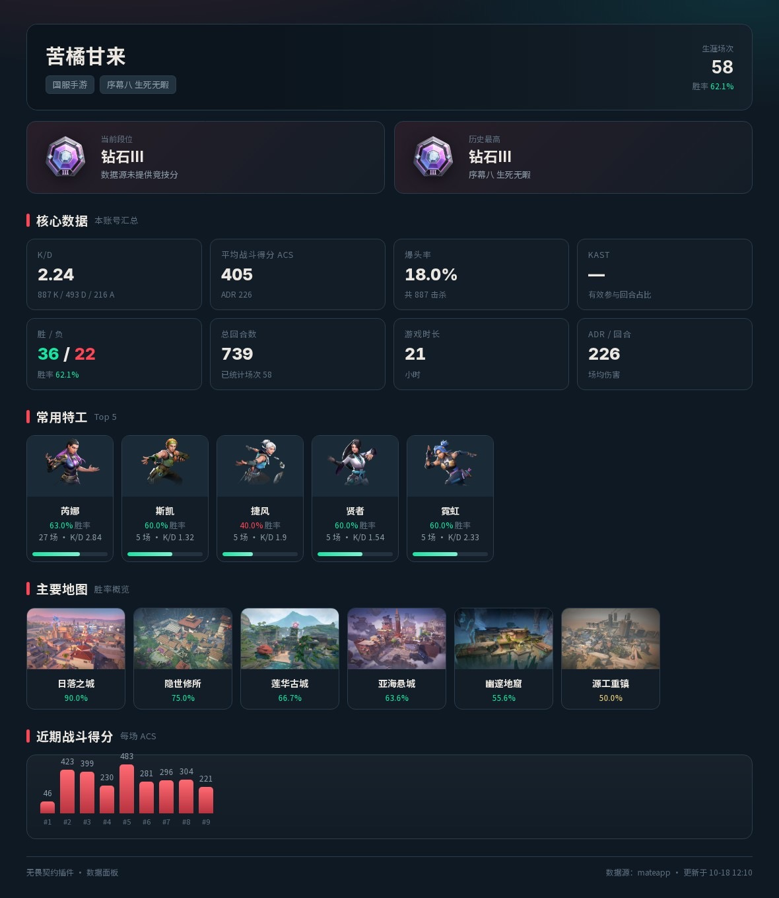
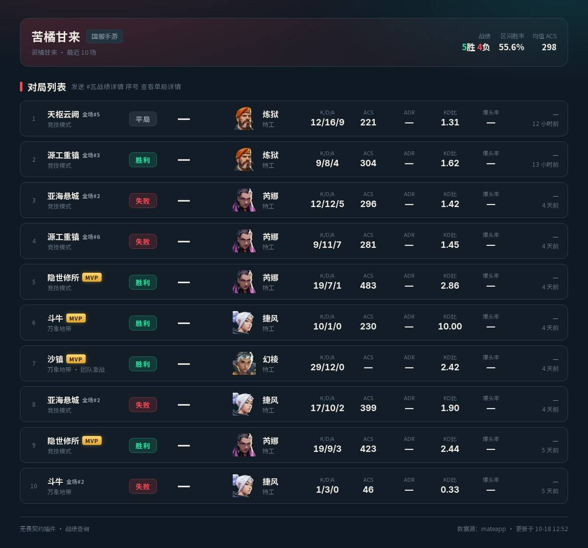
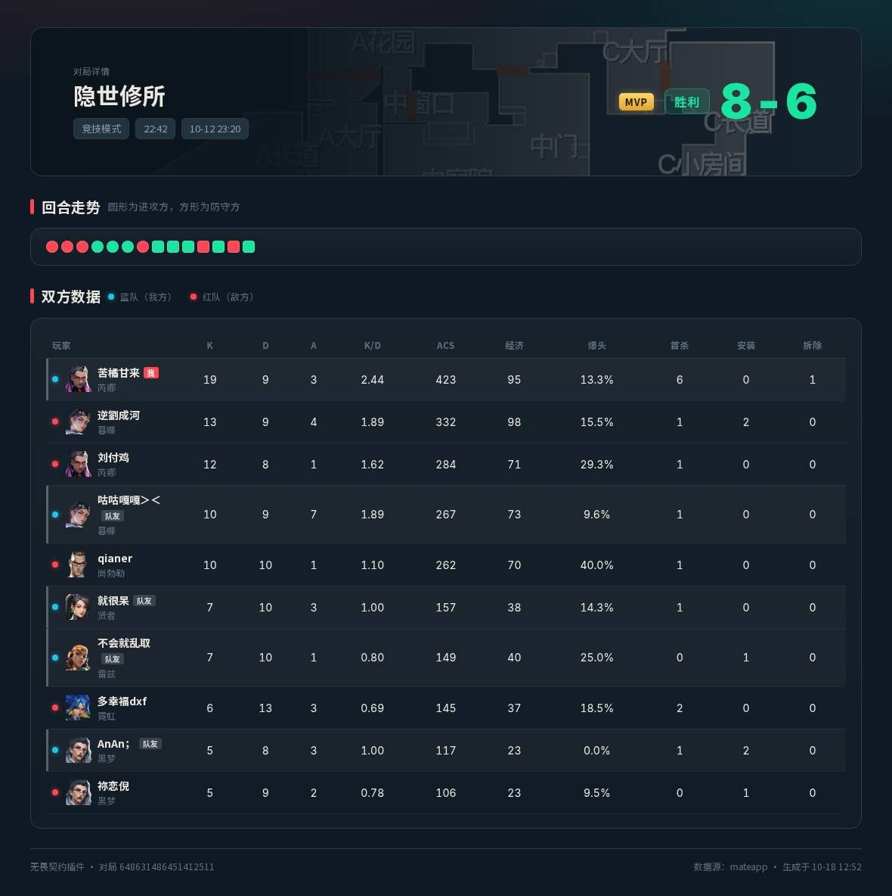

# 无畏契约插件

给云崽（TRSS-Yunzai / Yunzai V3）加无畏契约查询，出图。手游国服掌瓦的数据能查，指令前缀 `#瓦`。

先说登录：发 `#瓦扫码登录`，手机 QQ 扫一下就完事，不用抓包。
真扫不通（服务器连不上 QQ、或被风控）再退回抓包，`#瓦导入` 粘一次就行。

## 效果如图



`#瓦面板` — 段位、K/D、ACS、爆头率、常用特工、主要地图、近期走势。



`#瓦战绩` — 最近 10 场。MVP 和「全场第 N」直接打在右上角，不用自己算。



`#瓦战绩详情` — 十个人逐项摆开，🔵 我方 🔴 敌方，自己那行左边有道亮条。

## 安装

在云崽根目录：

```bash
git clone https://github.com/Looking08/Valorant-Plugin.git ./plugins/Valorant-Plugin
cd ./plugins/Valorant-Plugin && pnpm install
```

目录名得是 `Valorant-Plugin`，代码里写死了。重启云崽，日志里出现「无畏契约插件载入完成 / 成功加载：9 个」就算挂上了。

之后升级用 `#瓦更新`，不用再进目录。

<details>
<summary>docker 跑 TRSS_AllBot 的看这里</summary>

插件目录是容器里的 `/root/TRSS_AllBot/TRSS-Yunzai/plugins/Valorant-Plugin`，
宿主机一般在 `~/TRSS_AllBot/TRSS-Yunzai/plugins/`，直接扔进去，TRSS 会热加载。
</details>

## 装到 ALemonJS

除了云崽，同一份代码也能跑在 [ALemonJS](https://github.com/lemonade-lab/alemonjs) 上（QQ / Discord / KOOK / Telegram / OneBot / 飞书 … 一套代码通吃）。

在你的 alemonjs 项目里：

```bash
npm i valorant-plugin
# 出图用的，不装也能跑（只是所有图片会退化成文字）
npm i art-template puppeteer
```

然后在 `alemon.config.yaml` 里挂上：

```yaml
apps:
  - valorant-plugin
```

启动，日志里出现「[瓦插件] 已挂载（ALemonJS 适配层）」就成了。指令和云崽完全一样。

<details>
<summary>适配是怎么做的（想改代码看这里）</summary>

两个框架的差别只在「怎么注册指令、怎么发消息、怎么出图」，业务逻辑一点没动：

| | 云崽 | ALemonJS |
| --- | --- | --- |
| 入口 | `index.js` 导出 `{ apps }` | `alemon.js` 导出 `defineChildren` |
| 指令 | 框架读 `rule[].reg` 正则 | `router.res({regular})` 总入口 → `adapter/alemon/dispatch.js` 自己按 rule 分发 |
| 事件 | `e.msg` / `e.user_id` / `e.at` / `e.reply()` | `adapter/alemon/event.js` 把 alemonjs 事件**伪装成云崽的 e** |
| 出图 | 框架自带 puppeteer + art-template | `adapter/alemon/render.js`（art-template + puppeteer） |
| `plugin` 全局 | 框架提供 | `adapter/shim.js` 补 |

所以加指令只改 `apps/`，两边同时生效。扫指令表的逻辑抽在 `adapter/apps.js`，两边共用同一份，不可能对不上。

离线自检：`node test/alemon-smoke.mjs`（不需要装 alemonjs）。
</details>

## 起数据源

插件不直接连游戏接口，中间隔一个小网关（`bridge/`，**零依赖**，只要装有 node）。

**网关代码随仓库一起下载，但它不会自己跑起来。** 所以插件做了一件事：发现本机网关连不上，
就自己把 `bridge/server.mjs` 拉起来（`gateway.autoStart`，默认开）。新手什么都不用做：

```bash
git clone https://github.com/Looking08/Valorant-Plugin.git ./plugins/Valorant-Plugin
cd ./plugins/Valorant-Plugin && pnpm install
# 重启云崽，日志里出现「[瓦插件] 已自动拉起本地网关」就是了
```

这时候用的是 `demo` 数据源——数据是编的，但图是真的，先看效果、调 UI 正好。

想自己管（生产环境推荐，崩了能看见日志）就手动起，插件看到端口有响应就不会再插手：

```bash
cd plugins/Valorant-Plugin
TOKEN=你的令牌 pnpm bridge          # 前台跑，Ctrl-C 停
```

然后把 `config/config/config.yaml` 的 token 改成一样的（`.url` 默认就是 `127.0.0.1:7820`，改完热更新）。

> `autoStart` **只对本机地址生效**。`gateway.url` 指向别人的机器时，连不上也不会去拉——那是人家的事。

### 换成真实数据

`demo` 之上是 `mateapp`，需要一个**你自己的掌瓦登录态**（抓包得来的 `bridge/mate.json`）：

```bash
cp bridge/providers/mateapp.example.json bridge/mate.json
# 往里填 login.cookie / login.scene，怎么来的见下面「抓包导入」
```

`gateway.provider` 留空时自动判断：`bridge/mate.json` 里有 cookie、或 `bridge/accounts/` 下已经有人导入过，
就用 `mateapp`，否则 `demo`。想锁死就填 `demo` / `mateapp`。

> **不用手动做这一步。** 直接发 `#瓦导入 <cURL>` 就行：插件会先看网关 `/health` 的 `multiUser`，
> 发现是 `demo` 就自动把它换成 `mateapp` 重起一次再导入。
> 只有网关是你自己用 systemd / tmux / `pnpm bridge` 常驻起的（插件杀不掉）才需要手动改 PROVIDER ——
> 那种情况插件会直接把该执行哪条命令打给你。

⚠️ `bridge/mate.json`、`bridge/accounts/`、`config/config/`、`data/` 都在 `.gitignore` 里，**不会随仓库分发**。
理由很直白：那几个文件里是你的登录 cookie，谁拿到谁就能查你的号。

## 指令

| 指令 | 干什么 |
| --- | --- |
| `#瓦面板` | 生涯面板 |
| `#瓦战绩 [条数]` | 最近对局，默认 10，最多 30 |
| `#瓦战绩 <昵称>` | 查同过场的人。**只能查跟你打过同一局的人** |
| `#瓦战绩详情 <序号>` | 单局详情。`#瓦对局详细 9`、`#瓦详细 9` 也认 |
| `#瓦同场` | 收录了哪些同过场的人 |
| `#瓦隐藏战绩` | 把自己从这份名单里撤掉 |
| `#瓦枪械 [击杀\|爆头\|伤害\|命中\|回合]` | 枪械熟练度 |
| `#瓦扫码登录` | 机器人出码，手机 QQ 扫一下登录 |
| `#瓦登录` | 登录状态；扫码不行时给抓包步骤 |
| `#瓦导入 <粘贴 cURL>` | 抓包导入登录态，导入完就能查 |
| `#瓦登录状态` / `#瓦退出登录` | 还能不能用 / 删掉换号 |
| `#瓦绑定 昵称` | 一般用不上，导入时会自动绑 |
| `#瓦可选账号` | 列出这个登录态下真实能查的号；再 `#瓦绑定 序号` 就绑上，不用猜名字 |
| `#瓦账号` / `#瓦切换 <序号>` / `#瓦删除 <序号>` | 多账号 |
| `#瓦状态` | 自检，通了没 |
| `#瓦清缓存` / `#瓦更新` | 主人的活 |

前缀写 `瓦` 或 `无畏契约` 都行，`#` 可以不写。

## 登录

> ⚠️ **扫码登录暂时不可用（2026-10 实测）。**
>
> 腾讯给掌瓦这个 appid 分配的 `check_sig` 前置机下线了：扫码、手机确认、`ptqrlogin` 返回
> `code=0 登录成功` 全都正常，但最后换 token 的那一跳被指到
> `ptlogin4.openmobile.qq.com` / `ptlogin4.graph.qq.com`——这两台的权威 DNS 现在返回 `0.0.0.1`，
> 登录集群上也没有对应的 vhost。换主机名会被弹回不带 `code` 的 `s_url`。
>
> 掌瓦 App 自己不受影响，因为它走 QQ SDK 的 SSO，根本不经过 `check_sig`；服务器端复现不了。
> 排查过程和证据记在 `bridge/providers/mateapp-scanlogin.md`。
>
> `#瓦扫码登录` 仍然能用，但会先弹一段提醒再发码——不会假装没事让你白扫。
> `bridge/login/qq.js` 里换掌瓦凭证的后半段是完好的，
> 哪天拿到一个可用的 QQ `openid` + `access_token`，接上就能跑。

所以现在只有一条路：**抓包导入**（下一节）。导入一次能用 3 天，期间网关自动续期。

## 抓包导入

目前唯一能拿到真实数据的路，走通了就一直可用。

1. 手机装个抓包 App（安卓 Reqable，iPhone Stream / Thor），按引导装证书。iPhone 还得去「设置 → 通用 → 关于本机 → 证书信任设置」把开关打开，这步忘了就什么都抓不到。
2. 开着抓包打开掌瓦，进「我的 → 战绩」，下滑一下，点进任意一局。
3. 回到抓包 App，按 `app.mval.qq.com` 过滤，找 `career/record/list`，长按 →「复制为 cURL」。再找 `career/record/player/rounds`，也复制一份。
4. 发 `#瓦导入`，把两段一起粘上来。整段粘，别删东西，插件自己拆。

有电脑的话可以省掉手抄：

```bash
node tools/har2cred.mjs 掌瓦.har                    # 打出一行，自己发群里
node tools/har2cred.mjs 掌瓦.har --docker --user=你的QQ --token=网关令牌
```

**登录态的有效期是硬 3 天。** 抓来的票据里带着一个底层 web ticket，服务端明确给了起止时间：

```
auth web ticket fail err=DecodeTgpTicket err=ticket expire
now=1792557703 validFrom=1792295134, validTo=1792554334
```

实测一份：`validFrom` 到 `validTo` 正好 **259200 秒 = 3 天整**，到点就失效，没有缓冲。

网关每 25 分钟续的是**上层 access_token**（那个只管 1 小时，`time_interval=3600`），
**续不到这个 3 天的底层票据** —— 真能续它的 `refresh_client_ticket` 要 `ct` 且需要 App 签名，
我们拿不到。所以：

- 3 天内：随便用，网关自己续 access_token，你不用管
- 满 3 天：查询会直接报「登录态失效」，**重新抓一次再导入**就行，不影响别人

不确定还有效没，发 `#瓦登录状态`。

## 注意事项

- 扫码那条路暂时堵死了（见「登录」），只能抓包。登录态**硬 3 天**过期，网关自动续的是上层 access_token（`KEEP_ALIVE=0` 关掉），续不到那 3 天 —— 到期只能重抓。
- 掌瓦不给的就显示「—」：KAST、枪械总伤害。列表里的比分、ADR、爆头率、回合数、时长是从记分板顺手取的（不额外发请求），`mvp.lookup: false` 关掉记分板查询时它们会一起变「—」。
- 别人只能查「跟你同过一场」的，陌生人查不了：掌瓦没有按昵称搜人的接口，试过，服务端连表都没有。面板同理，只认自己的登录态。

